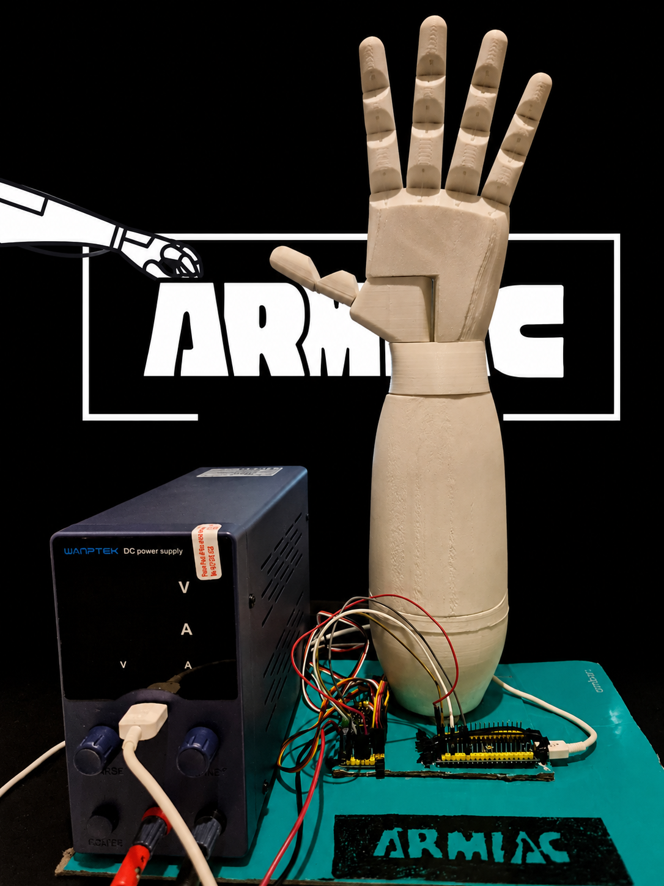

# ARMIAC — Intelligent Robotic Hand

A 3D-printed robotic hand controlled by an ESP32 and a Flutter Android app. Developed as my 2025/2026 Professional Aptitude Project (PAP), ARMIAC demonstrates how mobile software, Wi-Fi, electronics and mechanical parts work together.

The app opens and closes the hand, controls fingers and the forearm, runs predefined gestures and accepts voice commands, with Portuguese and English interfaces.

## See it in action

[](https://www.youtube.com/watch?v=DZ1Mz6-E2Yc)

[Watch the final demonstration](https://www.youtube.com/watch?v=DZ1Mz6-E2Yc) · [More development videos](Videos%20-%20EN.md)

The videos are in Portuguese.

## How to use it

1. Assemble and power the ESP32, PCA9685 and servos using the wiring and mechanical details in the [PAP report](Relat%C3%B3rio%20PAP%20Final.pdf).
2. Upload [armiac.ino](arduino%20ide%20-%20esp32%20code/armiac.ino) using Arduino IDE with ESP32 board support and the Adafruit PWM Servo Driver library installed. `WiFi`, `WebServer` and `Wire` come with the board/core libraries.
3. Connect the Android phone to the **ARMIAC** Wi-Fi network. The firmware's default password is `12345678`; the app contacts `http://192.168.4.1`.
4. Open the app, connect, then try opening/closing the hand and the individual movement controls.
5. Grant microphone permission to try voice commands; the app includes a tutorial and command reference.

The physical hardware is required to demonstrate movement. Servo power, wiring and calibration must match the actual assembly; consult the report before operating it.

## Build the Android app

Use Flutter with Dart **>=3.10.0 <4.0.0**, Android tooling and a connected device. From the repository root:

```bash
cd app_flutter
flutter create --platforms=android .
flutter pub add flutter_tts shared_preferences
flutter pub get
```

The repository contains the Dart sources but no Android platform directory. It also imports `flutter_tts` and `shared_preferences` without declaring them in `pubspec.yaml`; the commands above generate the platform files and add those dependencies.

Before running, add `assets/tutorial/armiac_wifi.png` to the existing `flutter.assets` list in `pubspec.yaml`. In `android/app/src/main/AndroidManifest.xml`, add `android.permission.INTERNET` and `android.permission.RECORD_AUDIO` as `<uses-permission>` entries, and enable local HTTP with `android:usesCleartextTraffic="true"` on `<application>`. Check the speech plugin's Android setup when generating fresh platform files.

```bash
flutter run
# To produce a release APK after configuration:
flutter build apk --release
```

These are source setup instructions; an Android build has not been verified as part of this documentation update. The checked-in package version is `1.0.0+1`.

## Hardware and documentation

Commands travel from **Flutter → Wi-Fi/HTTP → ESP32 → I2C → PCA9685 → servos**.

| PCA9685 channel | Movement |
| --- | --- |
| 0 | Thumb base |
| 1 | Thumb flexion |
| 2 | Index finger |
| 3 | Middle finger |
| 4 | Ring and little fingers together |
| 5 | Forearm |

- [Portuguese final report](Relat%C3%B3rio%20PAP%20Final.pdf)
- [English report — AI translation](PAP%20Final%20Report%28Translated%20by%20AI%29.pdf)
- [3D models archive](3d%20models/3D%20models.rar)
- [Flutter source](app_flutter/lib/) and [package configuration](app_flutter/pubspec.yaml)

The PAP prototype is complete. A second hand/arm and research into spoken-language-to-sign-language gestures are future ideas; sign-language translation is **not implemented**. Further development depends on resources and funding.

Created by **Quévin Leonardo Aguiar Tavares**, vocational course in Computer Systems Management and Programming. Shared for educational, academic and portfolio purposes.
